<picture>
  <source media="(prefers-color-scheme: dark)" srcset="./assets/profile/hero-dark.svg">
  
</picture>

  
  
  

  
  
   
  
  

I'm Karthik, an AI engineer in Hyderabad, finishing a computer science degree in 2027. I build LLM agents and retrieval systems, and the evaluations that show whether they work.

Some of that work is already in front of users. At Hecta Proptech I built a machine learning model that predicts which bank auction notices will reach auction. It runs on a website used by 5,000+ people a day and cut manual review by about 80%. Before that I was the only full-stack engineer at a startup, building its marketplace for creative talent.

## What I'm looking for

The problems I like most start after a system reports that it works. The HackerRank Orchestrate challenge I won was one of those: a dashboard showed a customer's data as deleted while copies still sat in other systems, and my agent had to find them.

I'm looking for an applied AI, AI infrastructure or agent engineering role on a team that ships models to real users and reviews code closely. I like the work after the first demo: building the test set that shows where an agent breaks, then making it cheap and fast enough to run every day.

## Projects

<table>
<tr>
<td width="50%" valign="top">

**[Ghost Data Still Exists](https://github.com/G26karthik/ghost-data-still-exists)** 
1st of 4,650, HackerRank Orchestrate

Checks whether a customer's "deleted" data is really gone. An LLM agent investigates with read-only tools, and a rule engine has to agree before its answer passes. Running all 518 requests cost about $0.47.

Python · OpenAI tool calling · SQLite · 63 tests

</td>
<td width="50%" valign="top">

**[BizMatch](https://github.com/G26karthik/bizmatch-amazon-ml-2026)** 
38th of 32,000+ teams, Amazon ML Challenge 2026, team lead

Matches about 10M messy business records to 1.7M businesses and rejects look-alikes. TF-IDF and embedding search, then a LightGBM prune, keep 98.75% of true matches at about 5 candidates per business. More LightGBM stages and cross-encoders decide. Scored 0.990 F0.5.

Python · sentence-transformers · LightGBM · cross-encoders

</td>
</tr>
<tr>
<td width="50%" valign="top">

**[Grounded Support Triage](https://github.com/G26karthik/grounded-support-triage)** 
Retrieval agent for support tickets

Answers a ticket from the company's own help documents, or hands it to a person. It combines keyword and embedding search, and a separate check rejects answers whose citations don't hold up.

LangGraph · BM25 · sentence-transformers · reranking

</td>
<td width="50%" valign="top">

**[ParallaxOps](https://github.com/G26karthik/parallaxops)** 
3D reconstruction platform

Turns photographs into a 3D point cloud and checks the geometry of each result. On a public benchmark scene, camera position error was 0.31% of rig spread. In load tests, API p95 latency was 351 ms with 32 concurrent users.

Temporal · COLMAP · Fastify · Next.js

</td>
</tr>
</table>

Also worth a look: a [WhatsApp notification router](https://github.com/G26karthik/whatsapp-notification-router) that placed 20th of 1,983 in an earlier HackerRank Orchestrate. [All projects are on my portfolio.](https://g26karthik.dev/projects/)

## Latest work

**AI Engineer Intern, RamanIQ** (August to October 2026)

I built REFEREE, a product that reads a research paper, runs experiments to test its main claims and reports whether each one holds, with the evidence. It pairs several LLM agents with deterministic pipelines and reached about 87% accuracy on reproduction evaluations. 185 tests guard the rules behind its verdicts.

To feed it, I screened 36,000+ papers from seven venues down to 380+ that can be reproduced on limited hardware. I also had 12 pull requests merged into the company's other products.

[Earlier roles are on my portfolio.](https://g26karthik.dev/experience)

## Open source

I have 76 pull requests merged into 50 projects I don't own, plus 4 fixes that maintainers landed themselves and credited to me. Most are bug fixes that come with a regression test. A few of them:

- [PyTorch](https://github.com/pytorch/pytorch/pull/199953): SGD now rejects a NaN learning rate, momentum or weight decay instead of training on NaN.
- [Sentence Transformers](https://github.com/huggingface/sentence-transformers/pull/4223): GISTEmbedLoss now follows the same objective on several GPUs as on one.
- [Hindsight](https://github.com/vectorize-io/hindsight/pull/5092), an agent memory system: fixed two ways audit log entries were silently lost.
- [mem0](https://github.com/mem0ai/mem0/pull/3549): added Azure AI Search as a vector store in the TypeScript SDK.
- [libuv](https://github.com/libuv/libuv/pull/5411): the decoder now rejects malformed text that could turn into `/` or a NUL byte inside Windows paths.

On the security side, I'm credited as reporter of a high-severity advisory in Kinto ([GHSA-j22j-w4x4-3f6x](https://github.com/Kinto/kinto/security/advisories/GHSA-j22j-w4x4-3f6x), fixed in 26.6.0) and listed in the [Langfuse security hall of fame](https://langfuse.com/security/responsible-disclosure#hall-of-fame).

[Every contribution, with a short note on each](https://g26karthik.dev/open-source/)

## Tools I use

| Area | Tools |
|---|---|
| LLMs and agents | OpenAI, Anthropic and Gemini APIs, tool calling, LangGraph, Google ADK, evals |
| Retrieval | sentence-transformers, BM25, cross-encoder reranking, Qdrant, pgvector |
| Machine learning | PyTorch, Transformers, LightGBM, CatBoost, scikit-learn |
| Services | Python, TypeScript, Go, FastAPI, Next.js, Postgres, Redis, Celery |
| Infrastructure | Docker, Kubernetes controllers, Temporal, GitHub Actions |
