<picture>
  <source media="(prefers-color-scheme: dark)" srcset="./assets/profile/hero-dark.svg">
  
</picture>

  
  
  

  
  
   
  
  
  
  

**Applied AI engineer and researcher.** I build AI systems that hold up on data they have never seen, and I research how LLMs and quantum models behave. I built REFEREE, an autonomous research-review product, as an AI engineering intern at RamanIQ, and shipped production ML at Hecta Proptech. I am first author of three papers on quantum ML, LLM quantization and coding-agent security. B.Tech CSE '27, Hyderabad, looking for applied AI and ML roles.

<table align="center">
  <tr>
    <td align="center">COMPETITION<h3>1st of 4,218</h3>HackerRank Orchestrate, Oct 2026</td>
    <td align="center">MERGED UPSTREAM<h3>24 PRs</h3>across 18 projects, 338K+ combined stars</td>
    <td align="center">RESEARCH<h3>3 papers</h3>first author: quantum ML, quantization, agent security</td>
  </tr>
</table>

## Featured projects

<table>
<tr>
<td width="50%" valign="top">

**[REFEREE](https://github.com/G26karthik/referee)**: claim verification for research papers 
`built at RamanIQ` `multi-agent` `Docker`

- Reads a paper, lists its main claims, runs a test for each in Docker and writes a reviewer page: Verified or Not verified, with the evidence.
- **~87% accuracy** on evals and tests, **185 kernel tests**, and **36K+ papers** screened to curate 380+ reproduction candidates.

</td>
<td width="50%" valign="top">

**[AlgoSentinel](https://github.com/G26karthik/algosentinel)**: autonomous PR auditor 
`agents` `Docker sandbox` `Gemini`

- Profiles the old and new version of every changed function in a sandbox and fits growth curves to catch **O(n) to O(n²)** regressions that tests miss.
- **55 tools across 4 namespaces**, subagent orchestration, **26 tests**, and an eval harness at **F1 1.00** on 5 golden cases.

</td>
</tr>
<tr>
<td width="50%" valign="top">

**[FounderOS](https://github.com/G26karthik/FounderOS)**: voice-first AI chief of staff 
`🥈 2nd prize` `Qdrant` `parallel agents` · [live demo](https://founder-os-pi-lemon.vercel.app/)

- Turns spoken thoughts into decisions, tasks and ideas with **5 Lyzr agents** (three extractors run in parallel) over **4 Qdrant memory collections**.
- Live in production with a privacy-first design: raw conversation stays private.

</td>
<td width="50%" valign="top">

**[Buy or Wait?](https://github.com/G26karthik/Buy-OR-Wait-Agentic-Decision-System)**: cash-flow decision engine 
`exact Decimal` `LLM perception` `independent verifier`

- Recommends pay, wait, installments or decline from a 90-day forecast. The LLM reads documents; exact-arithmetic code does the money.
- **318 tests across 18 suites**, with **233 of 250** decisions identical to an independent reference evaluator.

</td>
</tr>
<tr>
<td width="50%" valign="top">

**[Closer](https://github.com/G26karthik/Closer)**: deadline agent on Google ADK 
`planner` `evaluator loop` `human-in-the-loop`

- Turns a goal and deadline into finished work: draft emails, calendar blocks, research and documents, pausing only for real decisions.
- **58 tests**, a judge that grades each specialist's output with an automatic retry, and a scheduled monitor for closing deadlines.

</td>
<td width="50%" valign="top">

**[BizMatch](https://github.com/G26karthik/bizmatch-amazon-ml-2026)**: Amazon ML Challenge 2026 
`🏆 38th of 32,000+` `entity resolution` `team lead`

- Finds every real copy of a business across **~10M noisy records** and rejects look-alike decoys: e5 retrieval, a LightGBM cascade and cross-encoders.
- **0.921 to 0.990 F0.5** on free compute. [Engineering write-up](https://g26karthik.dev/writing/amazon-ml-challenge-2026/).

</td>
</tr>
</table>

More: [ParallaxOps](https://github.com/G26karthik/parallaxops) (3D reconstruction platform) · [Nishchay](https://github.com/G26karthik/Nishchay) (COD risk engine) · [WhatsApp Notification Router](https://github.com/G26karthik/whatsapp-notification-router) · [Grounded Support Triage](https://github.com/G26karthik/grounded-support-triage) · [Setu](https://github.com/G26karthik/Sethu-AI) (district health network) · [EdgeSentinel](https://github.com/G26karthik/EdgeSentinel) · [Avia](https://github.com/G26karthik/Avia) · [full list on the portfolio](https://g26karthik.dev/projects/)

## Research

| Paper | Status | Focus |
|---|---|---|
| [**QNC**](https://github.com/G26karthik/QNC): Geometry Conservation in Variational Quantum Classifiers | Springer *Quantum Machine Intelligence*, major revision | Training rotates states exactly (~10⁻¹⁵ relative change), checked on two IBM quantum backends, 52 preregistered predictions |
| Language-Aware Calibration and Bit Allocation for Low-Bit Quantization of Indic Language Models | RAIT 2027, under review | English-calibrated 3-bit GPTQ raises Indic bits per byte 2.05× vs 1.15× on English; balanced calibration cuts it to 1.38 |
| CANARYCODE: Benchmarking and Mitigating Sensitive-Data Leakage in LLM Coding Agents | DAI 2026, under revision | 786 completed runs across three open-weight models, eight output surfaces |

Also: [KVQuant Lab](https://github.com/G26karthik/kvquant-lab) (4.65× KV-cache compression at near-baseline perplexity) and [TraceWarrant](https://github.com/G26karthik/tracewarrant) (do your traces support your performance claims?).

## Experience

| Role | Where | What I did |
|---|---|---|
| **Applied AI Engineer Intern** | RamanIQ (AI startup) · Aug – Oct 2026 | **REFEREE**, an autonomous research-review product: multi-agent orchestration plus deterministic pipelines for paper analysis, experiment execution and evidence-backed verdicts, at **~87% accuracy on evals and tests**. Screened **36K+ papers** to curate 380+ reproduction candidates. **19+ PRs** shipping connectors, UI and backend features |
| **Tech Engineer, AI & Backend** | Hecta Proptech · Jun – Jul 2026 | CatBoost + GPU embeddings over **175K+ auction notices**: **84.3% ROC-AUC**, **80% less manual review**. A Cox survival model (**0.79 C-index**) behind a validated Flask API, and the first hybrid RAG platform. Features serving **5K+ users a day** |
| **Full Stack Engineer (sole)** | chkchk (stealth startup) · Jan – Apr 2026 | A creative-talent marketplace end to end on Next.js and Supabase: **−50% DB calls, −30% latency**, realtime, EC2 + CI/CD, and the Android app. **66 of 74 commits** |

## Open source

**24 merged PRs across 18 projects**, including PyTorch, mem0, Hindsight and pandas. [Browse them all](https://github.com/search?q=author%3AG26karthik+is%3Apr+is%3Amerged&type=pullrequests)

| Project | What I contributed | Status |
|---|---|---|
| [PyTorch](https://github.com/pytorch/pytorch/pull/199953) · 105K★ | `SGD` now rejects NaN `lr`, `momentum` and `weight_decay` instead of silently training on NaN, matching the other optimizers | ✅ Merged |
| [mem0](https://github.com/mem0ai/mem0/pull/3549) · 67K★ | The Azure AI Search vector store for the TypeScript SDK: hybrid search and quantization, **754 lines** | ✅ Merged |
| [Hindsight](https://github.com/vectorize-io/hindsight/pull/5092) · 50.6K★ | Fixed audit-log rows silently lost to garbage-collected write tasks and at shutdown | ✅ Merged |
| [pandas](https://github.com/pandas-dev/pandas/pulls?q=is%3Apr+author%3AG26karthik) · 50K★ | A PyArrow datetime-merge regression test, Ruff B905 enforcement, and a docstring migration | ✅ 3 Merged |
| [Langfuse](https://github.com/langfuse/langfuse/pull/14789) · 36K★ | Found a prompt-cache key collision (version `3` vs label `"3"` served each other's prompt) | 🚀 Shipped via [#15040](https://github.com/langfuse/langfuse/pull/15040) |
| [matplotlib](https://github.com/matplotlib/matplotlib/pull/30639) · 23K★ | Documented the TwoSlopeNorm linear-colorbar workaround | ✅ Merged |
| [sktime](https://github.com/sktime/sktime/pull/8923) · 10K★ | Fixed broken pytorch-forecasting references in the forecaster adapters | ✅ Merged |
| [SQLFluff](https://github.com/sqlfluff/sqlfluff/pull/7163) · 10K★ | A PostgreSQL `OPERATOR(schema.op)` parser, **649 lines** with fixtures | ✅ Merged |
| [HackerRank hiring-agent](https://github.com/interviewstreet/hiring-agent/pulls?q=is%3Apr+author%3AG26karthik) · 7.3K★ | Fixed a PyMuPDF memory leak and a Windows UTF-8 crash | ✅ 2 Merged |
| [PyTorch-Ignite](https://github.com/pytorch/ignite/pull/3876) · 4.8K★ | `ReduceLROnPlateauScheduler` now honours `min_lr` for every param group, not only the first | ✅ Merged |
| [NumPyro](https://github.com/pyro-ppl/numpyro/pulls?q=is%3Apr+author%3AG26karthik+is%3Amerged) · 2.8K★ | Hurdle distributions over positive bases now include zero in their support, and `init_to_mean` falls back to the median when the mean is not finite | ✅ 2 Merged |
| [QuTiP](https://github.com/qutip/qutip/pull/3049) · 2.1K★ | `rand_dm` and `rand_herm` no longer hang forever when all eigenvalues are equal | ✅ Merged |
| [pymc-extras](https://github.com/pymc-devs/pymc-extras/pull/802) · PyMC ecosystem | Traced a Windows-only Pathfinder test failure to numba cache numerics and re-enabled the test with a better-conditioned model | ✅ Merged |

## Tech stack

   
  

LLMs &amp; ML: OpenAI · Claude · Gemini · LangGraph · Hugging Face · LightGBM · CatBoost · XGBoost · scikit-learn · FAISS · BM25 · GPTQ · PennyLane

## GitHub

  <picture>
    <source media="(prefers-color-scheme: dark)" srcset="https://github-readme-stats-fast.vercel.app/api?username=G26karthik&show_icons=true&include_all_commits=true&hide_border=true&hide_rank=true&theme=github_dark">
    
  </picture>
  <picture>
    <source media="(prefers-color-scheme: dark)" srcset="https://github-readme-stats-fast.vercel.app/api/top-langs?username=G26karthik&layout=compact&hide_border=true&hide=html%2Ccss&langs_count=8&theme=github_dark">
    
  </picture>

<picture>
  <source media="(prefers-color-scheme: dark)" srcset="https://raw.githubusercontent.com/G26karthik/G26karthik/output/snake-dark.svg">
  
</picture>
